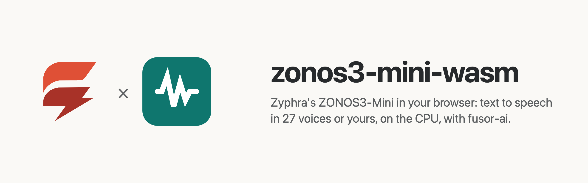
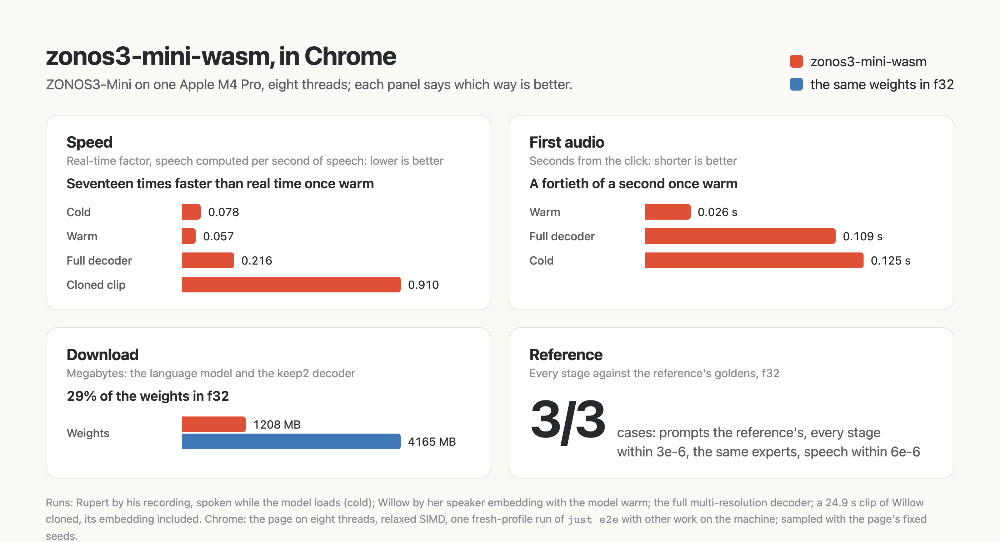

<p>
  <picture>
    <source media="(prefers-color-scheme: dark)" srcset="assets/brand/banner-dark.png">
    
  </picture>
</p>

# Text to speech in 27 voices or yours, in the browser, on the CPU

**[Try it in your browser](https://huggingface.co/spaces/fusorlabs/zonos3-mini-wasm)**: no install, no server. The model downloads once and runs on your CPU.

**Speech 17× faster than real time, the first audio 26 ms after the click** once the model has loaded, in headless Chrome on an Apple M4 Pro, eight threads. [How fast is it](#how-fast-is-it)

Type a text and Zyphra's [ZONOS3-Mini](https://huggingface.co/Zyphra/ZONOS3-Mini) speaks it, streamed to your speakers as it is computed on your own device: in one of its 27 default voices (by the voice's recording or by its speaker embedding), or in a voice cloned from a clip you drop into the page. No server, no API key, no GPU required, and once the model has loaded, neither the text nor the clip leaves the page.

zonos3-mini-wasm is the app around the model: a [fusor](https://github.com/fusor-rs/fusor) page, the browser runtime and a native CLI. The model itself, compiled to WebAssembly, is built with [fusor-ai](https://github.com/fusor-rs/fusor-ai), the toolkit for AI runtimes in Rust and WebAssembly, from the published weights.

**In development · v0.1**: this is experimental software. See [status and known limitations](#status-and-known-limitations).

[Run it](#run-it-locally) · [How it works](#how-it-works) · [How fast is it](#how-fast-is-it) · [Status](#status-and-known-limitations)

## Run it locally

You need Rust 1.99 or newer, installed with [rustup](https://rustup.rs), Node.js 22 or newer and [`just`](https://github.com/casey/just). Then:

```sh
git clone --recurse-submodules https://github.com/fusor-rs/zonos3-mini-wasm && cd zonos3-mini-wasm
just ui
```

and open the address it prints. `just ui` installs the pinned tools (the threads toolchain with rustup; wasm-bindgen, binaryen and the fusor CLI into `.tools/`), downloads the checkpoint at a pinned revision (14.3 GB, each file sha256-checked), compiles it into four bundles (the language model with its voices, speaker encoder, LACI heads and steering directions, 1046 MB; the keep2 decoder, 163 MB; the full multi-resolution decoder, 1146 MB; the clip encoder, 1575 MB), builds the four browser runtimes (a few minutes the first time, seconds after) and the page, and serves it on `http://localhost:8787` with the bundles beside it.

Pick a voice and whether it speaks from its recording or its speaker embedding, or drop a clip of any voice into the page: the page keeps its first 60 s, the most the reference reads, and clones it by its codes (as the reference does by default; the clip encoder is downloaded the first time) or by its speaker embedding. Type a text and press **Speak**, even while the model is still loading: it speaks the moment the model is ready. The page offers what the reference does: the three condition rows (speaking rate, loudness and bandwidth, each in the reference's buckets, or not set), speaker guidance, LACI (off by default, as in the reference) and the language whose alignment heads it reads, the voice designer's sliders and presets with the controls' guidance, the sampler's settings at the reference's defaults, and the decoder: keep2, the reference code's default, or the full multi-resolution decoder, downloaded when you choose it. Every take is measured live: the first audio from the click (and, for a clip, how long its encoding or embedding took), the real-time factor and the network requests since the model loaded (they stay at zero, but for the clip encoder's download).

The model reads text as written in its 43 languages: the reference's text normalization (numbers, dates, abbreviations) is not run, here or in the comparisons below.

## More ways to run it

### Build everything from source

```sh
just build    # also downloads the checkpoint (14.3 GB, sha256-checked) and compiles the bundles
just serve
```

`CHECKPOINT=<dir>` reuses a checkpoint you already have.

### The CLI

`zonos3-mini encode` turns a clip into the codes a request's speaker kind `codes` reads, `zonos3-mini speak` speaks a request (`session::Request` as JSON) without a browser, `zonos3-mini bench` measures each stage (`just bench`) and `zonos3-mini parity` compares every stage with the reference's outputs (`just parity`; `just goldens` dumps them from the reference on the CPU).

## How it works

- **The reference's prompt, row for row.** The speaker (a voice's recorded frames, or its embedding through the speaker projection), the three condition rows, the text with its pause and phoneme markers and the silence prefill are laid out as the reference lays them, with its delayed codebooks; every row of every golden prompt matches the reference's.
- **A hybrid mixture of experts.** Eleven layers, gated delta-rule layers with two global attention layers among them, every layer reading every earlier layer's output through Full Attention Residuals, and a latent mixture of 64 experts of which each row uses two; ten codebooks of 4,096 codes per 1/15 s frame, drawn with the reference's sampler (repetition penalty, temperature, top-k, top-p) from the page's seed.
- **Two engines at once.** The language model and the decoder run in two workers, each with its own memory and threads: each frame goes from the first to the second, and its samples from there straight to the speakers. The first chunk is decoded from its first codebook, as the reference's prefix stream does, so speech starts after a single frame.
- **The reference's decoders.** keep2 or the full multi-resolution decoder: semantic and residual codebooks into a latent, five causal transformers, ConvNeXt blocks and two inverse STFTs at 44.1 kHz, then the reference's gain and soft limiter.
- **Clones by their codes, or their embedding.** By default a clip is encoded as the reference encodes a reference clip: into the codec's own codes, read as the voice's recording. The clip encoder runs in a third worker, downloaded the first time a clip is cloned so: in lanes of 20 s (each after 10 s of the clip before it), DAC's encoder front and five causal transformers turn the clip at 44.16 kHz into its latent, w2v-BERT 2.0 reads it at 16 kHz into its semantic code, and nine residual codebooks quantize the rest. Or a clip goes through the reference's MECT-B2 encoder (Kaldi filterbanks at 16 kHz, 14 convolution and transformer blocks) in f32, its attention included, to a 192-value embedding.
- **LACI, as the reference guards a take.** With the switch on, and always for a short text (two words at most, read with the reference's pause and filler and cut where the filler starts), the attention of the language's alignment heads over the text is read after every row: a take that skips, stalls or stops before the text's end rolls back and is read again from row 0 under a new seed, the heads held to a window around the text they should read, and the end of audio is favored once the text is read. The replays the reference's servers test against give its sessions here, event for event.
- **Steering and voice design.** The reference's 65 directions: identity, accent, texture and room move the speaker embedding (so they need a voice by its embedding); delivery and mood add to two of the language model's residual sources on every generated row, at full dose for the first 4 s and then held at 35%, as the reference releases them. The page offers the reference studio's sliders and presets, and the controls' own guidance.
- **Quantized.** Every large matrix is 7-bit: 1208 MB for the language model and keep2, against 4165 MB for the same weights in f32. The f32 bundle runs the same code and matches the reference to about 1e-6 at every stage, so what the 7-bit bundle changes is the weights' format and nothing else.
- **Downloaded once, verified always.** The bundles stream in parts, each checked against its BLAKE3 hash, and stay in the browser's origin-private storage, so the next visit loads from this device.
- **Sealed.** The runtime imports no network, storage, clock or entropy capability; fusor-ai's import check proves it on every build. The page counts its network requests while it speaks, and the count is zero.

## How fast is it

On an Apple M4 Pro in headless Chrome on eight threads (`web-threaded-relaxed`, four for each engine), a request queued while the model loads gets its first audio 1.6 s after the page opens (the model loads in 1.4 s); with the model loaded, the first audio comes 26 ms after the click and the speech is computed in 0.057 of its length, 17× faster than real time. The full multi-resolution decoder computes speech in 0.22 of its length. A clip cloned by its codes is first encoded: 20.5 s for a 24.9 s clip, the clip encoder's download from the local server included (two lanes of 20 s through about 1.4 billion weights). A clip cloned by its embedding is first embedded: 4.0 s for a 24.9 s clip, 12.5 s for 60 s (the speaker encoder's attention grows with the square of the clip's length). A revisit loads the 1208 MB of bundles from the browser's storage in 1.0 s. Single-threaded, relaxed SIMD in Node computes a sentence in 0.30 of its length, SIMD128 in 0.86. The fixed default-voice takes are intelligible (faster-whisper word error rate 0):

<picture>
  <source media="(prefers-color-scheme: dark)" srcset="assets/benchmarks/benchmarks-dark.png">
  
</picture>

These are the figures of one `just e2e` run (a fresh profile, other work on the machine); `just bench` breaks a take down by stage natively.

### Against the reference

The same texts, voices and settings through the reference (f32, on the CPU) and here (the 7-bit bundle; the f32 bundle where it says so), compared as the other speech products are: faster-whisper's word error rate, the duration, and the similarity of each take's speaker embedding to the voice's own.

| Case | | Mean WER | Duration | Voice similarity |
| --- | --- | --- | --- | --- |
| Rupert by his recording, English | reference (3 seeds) | 0.000 | 4.60 s | 0.765 |
| | here, 7-bit (5 seeds) | 0.000 | 4.64 s | 0.719 |
| | here, f32 (5 seeds) | 0.000 | 4.64 s | 0.740 |
| Gaspard by his embedding, French, speaker guidance 1.5 | reference (3 seeds) | 0.152 | 5.22 s | 0.822 |
| | here, 7-bit (5 seeds) | 0.182 | 4.72 s | 0.822 |
| A 24.9 s clip of Willow, cloned by its embedding, English | reference (12 seeds) | 0.257 | 5.15 s | 0.485 |
| | here, 7-bit (30 seeds) | 0.378 | 4.90 s | 0.503 |
| The same clip, cloned by its codes, English | reference, its codes from its encoder in f32 (3 seeds) | 0.000 | 6.24 s | 0.827 |
| | here, the codes of the f32 encoder (3 seeds) | 0.026 | 5.98 s | 0.810 |
| | here, the codes of the 7-bit encoder (3 seeds) | 0.026 | 6.20 s | 0.779 |

The French error rates count "7h" for "sept heures" as an error on both sides. The error rates of a clip cloned by its embedding are those of takes that stop early (next section): the takes that run to their end read the text in both. The encoder in f32 gives the reference's codes for the clip, all ten codebooks, frame for frame; in 7 bits it keeps 92% of the semantic codes and moves most residual ones, which the residual codebooks' nearest-code choice amplifies.

## Documentation

| Guide | Covers |
| --- | --- |
| [AGENTS.md](AGENTS.md) | The code standard every change follows |

## Status and known limitations

zonos3-mini-wasm is v0.1 and experimental.

| Platform or capability | Status |
| --- | --- |
| Chrome and Edge, threads and relaxed SIMD | Headless Chrome end-to-end check (`just e2e`): send while loading, two default voices, a designed voice, a 60 s clip cloned by its embedding under LACI and a 24.9 s clip by its codes, the full decoder, revisit |
| Browsers without relaxed SIMD (Safari, older Firefox) | SIMD128 builds, checked in Node (`just smoke`); not tested in those browsers |
| Pages without cross-origin isolation | Single-threaded builds |
| Native CLI (macOS on Apple silicon) | Built and run on the fixed voices; no release archives yet |
| Phones | Not measured; each engine's memory may grow to 4 GB |

**Voices cloned by their embedding sometimes stop early, unless LACI is on.** With a voice cloned through its speaker embedding, some takes end after their first frames, in the reference as well: for a 24.9 s clip of Willow, 3 of 12 reference takes stopped in under 1.5 s. Over 64 seeds here, 26 takes of the f32 bundle stopped so, 37 with every large matrix in 7 bits and 33 of the shipped bundle, whose condition rows stay f32 (18, 40 and 30 for the clip looped to 60 s); keeping the embedding tables or the token mixers in f32 as well did not close the gap (39 and 33 of 64). With LACI on, 5 of the shipped bundle's 64 takes stopped early (7 for the 60 s clip), and the reference's first six seeds all ran to their end. A clip cloned by its codes, the page's default, did not stop early in these runs, nor did the default voices.

**Not supported yet:**

- Speech editing, the reference's text normalization and steering spans (controls that change within a take).
- A GPU backend.

The model is Zyphra's [ZONOS3-Mini](https://huggingface.co/Zyphra/ZONOS3-Mini), under the Apache-2.0 license.

## License

The code is licensed under the [MIT License](LICENSE). The model's weights are Zyphra's, under [Apache-2.0](https://huggingface.co/Zyphra/ZONOS3-Mini).
